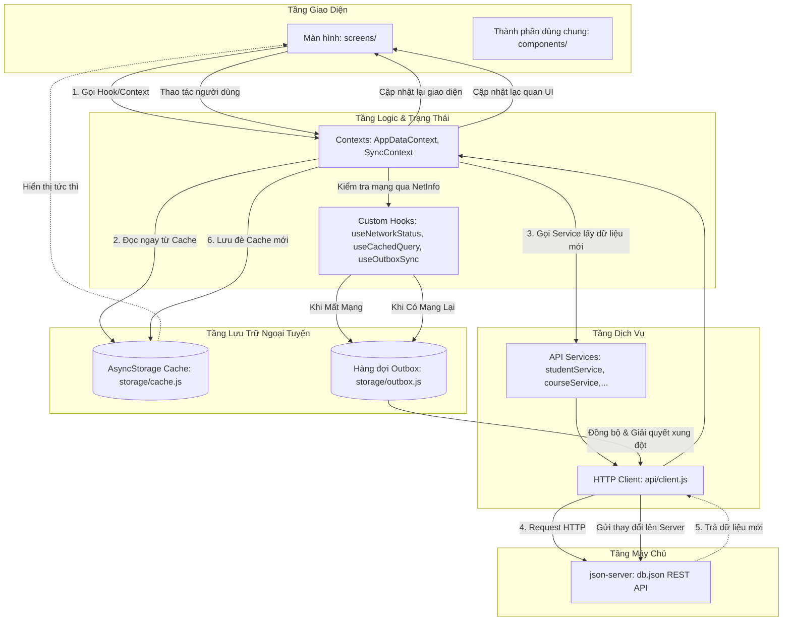
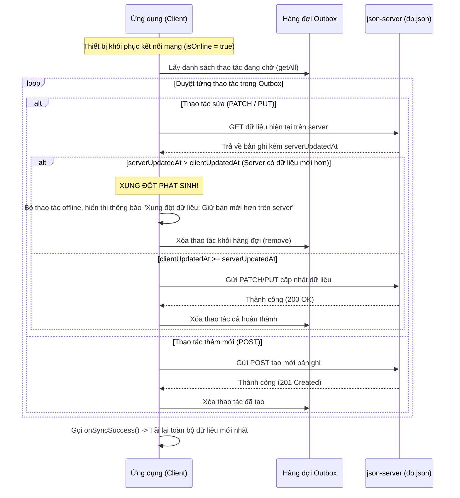

# ỨNG DỤNG QUẢN LÝ HỌC TẬP (STUDY MANAGER)
> **BÀI THỰC HÀNH 4: API & OFFLINE MODE**  
> Môn học: Phát triển ứng dụng trên thiết bị di động  
> Nền tảng: React Native CLI + TypeScript  

---

## 1. Hướng dẫn cài đặt và chạy ứng dụng

### 1.1. Yêu cầu môi trường
- **Node.js** >= 18.x
- **npm** >= 9.x
- **Android Studio** kèm Android SDK & Máy ảo Android (Android Emulator) hoặc thiết bị Android thật (bật USB Debugging).

### 1.2. Các bước khởi chạy

#### Bước 1: Cài đặt các gói phụ thuộc (Dependencies)
```bash
npm install
```

#### Bước 2: Khởi động Mock REST API Server (`json-server`)
Chạy máy chủ dữ liệu từ file `db.json` trên cổng `3000`:
```bash
npm run server
```
> *Lưu ý:* Terminal này cần được giữ nguyên chạy nền. API có thể kiểm tra qua trình duyệt tại: `http://localhost:3000/students/1`, `http://localhost:3000/courses`, `http://localhost:3000/sessions`, `http://localhost:3000/assignments`, `http://localhost:3000/grades`.

#### Bước 3: Cấu hình địa chỉ IP kết nối (Nếu cần)
Mở file `src/config.js`:
- **Chạy trên Máy ảo Android (Mặc định):**
  ```javascript
  export const BASE_URL = 'http://10.0.2.2:3000';
  ```
- **Chạy trên Điện thoại thật (Cùng mạng Wi-Fi với máy tính):**
  ```javascript
  export const BASE_URL = 'http://<IP_MÁY_TÍNH_LAN>:3000'; // Ví dụ: http://192.168.1.15:3000
  ```

#### Bước 4: Khởi động ứng dụng trên Android
Mở một cửa sổ Terminal mới và chạy:
```bash
npm run android
```

---

## 2. Sơ đồ luồng dữ liệu (Data Flow Architecture)

Ứng dụng tuân thủ nghiêm ngặt mô hình kiến trúc phân tầng một chiều, đảm bảo tính đóng gói và dễ bảo trì:



### Nguyên tắc phân tầng:
1. **Màn hình (`screens/`)**: Chỉ tương tác qua `Context`, `Hooks` và các `Components`. Không gọi trực tiếp `AsyncStorage` hay `fetch`.
2. **Thành phần (`components/`)**: Thuần giao diện (Presentational), chỉ nhận props và phát sự kiện qua callback (`onPress`, `onToggle`,...).
3. **Context & Hooks**: Điều phối luồng dữ liệu, lưu cache ngoại tuyến và quản lý hàng đợi Outbox.
4. **Dịch vụ (`api/`)**: Đóng gói các hàm gọi API RESTful tiêu chuẩn.

---

## 3. Cơ chế giải quyết xung đột dữ liệu (B5 - Conflict Resolution)

Để đảm bảo tính nhất quán dữ liệu giữa nhiều thiết bị và khi hoạt động ngoại tuyến, ứng dụng triển khai chiến lược **Timestamp-based Last-Write-Wins có kiểm tra xung đột**:

### 3.1. Cấu trúc Timestamp
- Mọi bản ghi có thể thay đổi (`Student`, `Assignment`) đều có trường `updatedAt` theo định dạng chuẩn ISO 8601 (ví dụ: `"2026-10-26T14:30:00.000Z"`).
- Khi người dùng chỉnh sửa ngoại tuyến (Offline), ứng dụng đóng gói:
  - Hành động HTTP (`PATCH` hoặc `PUT`)
  - Đường dẫn tài nguyên (`/assignments/1` hoặc `/students/1`)
  - Dữ liệu thay đổi kèm theo `updatedAt` tại thời điểm client sửa.
  - Lưu vào hàng đợi **Outbox** trong `AsyncStorage`.

### 3.2. Quy trình xử lý khi phát hiện có mạng trở lại (`useOutboxSync`)


---

## 4. Kịch bản kiểm thử (7 kịch bản bắt buộc phục vụ chấm điểm & quay video)

Ứng dụng đáp ứng trọn vẹn 7 kịch bản kiểm thử theo mục 6 của đề bài:

| STT | Kịch bản kiểm thử | Thao tác thực hiện | Kết quả hiển thị / Kỳ vọng |
|:---:|:---|:---|:---|
| **1** | **Khởi động lần đầu khi server tắt** | Tắt `json-server`, xóa dữ liệu app và mở ứng dụng. | Hiển thị màn hình lỗi (`ErrorView`) kèm thông báo và nút **"Thử lại"**, ứng dụng **không bị dừng/crash**. |
| **2** | **Xem dữ liệu khi mất mạng (Offline Cache)** | Bật `json-server`, mở app tải dữ liệu. Bật chế độ máy bay (Airplane Mode) và tắt/mở lại app. | Dữ liệu vẫn hiển thị đầy đủ từ Cache (`AsyncStorage`). Xuất hiện banner màu cam **"Bạn đang offline"** và dòng **"Cập nhật lần cuối: HH:mm, dd/MM/yyyy"**. |
| **3** | **Thao tác dữ liệu khi Offline** | Trong khi đang bật chế độ máy bay: Đổi trạng thái 2 bài tập (`todo` ↔ `done`) và thêm 1 bài tập mới. | Giao diện cập nhật tức thì (Optimistic Update). Các mục vừa sửa/thêm hiển thị nhãn màu đỏ/cam **"Chưa đồng bộ"**. |
| **4** | **Tự động đồng bộ khi có mạng lại** | Tắt chế độ máy bay (kết nối mạng trở lại). | `NetInfo` phát hiện mạng → tự động kích hoạt `useOutboxSync`. Các thao tác được gửi lên `json-server`. Nhãn **"Chưa đồng bộ"** tự động biến mất, file `db.json` được cập nhật chính xác. |
| **5** | **Xử lý xung đột dữ liệu (Conflict)** | Bật chế độ máy bay: Sửa Họ tên sinh viên trong app. Đồng thời trên máy tính, sửa trực tiếp `db.json` với trường `updatedAt` mới hơn (ví dụ năm 2030). Bật lại mạng. | Ứng dụng phát hiện server mới hơn, hiển thị hộp thoại cảnh báo xung đột dữ liệu và giữ lại thông tin mới nhất trên server. |
| **6** | **Trạng thái rỗng (Empty State)** | Tìm kiếm môn học với từ khóa không tồn tại (ví dụ: `xyz123`), hoặc lọc danh sách bài tập/học kỳ không có dữ liệu. | Hiển thị giao diện rỗng thân thiện (`EmptyState`) kèm thông báo rõ ràng, không bị lỗi màn hình trắng. |
| **7** | **Kéo để làm mới (Pull-to-refresh)** | Vuốt màn hình từ trên xuống ở các danh sách (Trang chủ, Môn học, Lịch học, Bài tập, Điểm). | Hiển thị con quay tải dữ liệu (`RefreshControl`) và nạp lại dữ liệu mới nhất từ server. |

---

## 5. Cấu trúc cây thư mục dự án

```
APP/
├── App.tsx                       # Cấu hình SafeAreaProvider, AppDataProvider, SyncProvider, AppNavigator
├── db.json                      # Dữ liệu Mock REST API (students, courses, sessions, assignments, grades)
├── package.json                 # Cấu hình scripts ("server", "start", "android") và dependencies
├── README.md                    # Tài liệu hướng dẫn, sơ đồ kiến trúc và kịch bản demo
└── src/
    ├── config.js                # BASE_URL (10.0.2.2:3000), TIMEOUT (10s), CACHE_TTL (24h)
    ├── api/                     # Tầng giao tiếp mạng
    │   ├── client.ts            # Hàm request chuẩn hóa timeout và phân loại lỗi
    │   ├── studentService.ts    # API sinh viên
    │   ├── courseService.ts     # API môn học
    │   ├── sessionService.ts    # API lịch học
    │   ├── assignmentService.ts # API bài tập
    │   └── gradeService.ts      # API điểm số
    ├── storage/                 # Tầng lưu trữ offline
    │   ├── keys.ts              # Hằng số khóa lưu trữ AsyncStorage
    │   ├── cache.ts             # getCache, setCache kèm timestamp savedAt
    │   └── outbox.ts            # Hàng đợi ngoại tuyến: enqueue, getAll, remove
    ├── context/                 # Quản lý trạng thái toàn cục
    │   ├── AppDataContext.tsx   # Chia sẻ dữ liệu 5 phân hệ, cập nhật lạc quan
    │   └── SyncContext.tsx      # Quản lý tiến trình đồng bộ outbox tự động
    ├── hooks/                   # Custom Hooks
    │   ├── useNetworkStatus.ts  # Lắng nghe trạng thái kết nối mạng qua NetInfo
    │   ├── useCachedQuery.ts    # Chiến lược nạp dữ liệu: Cache-first, Network-after
    │   └── useOutboxSync.ts     # Xử lý hàng đợi outbox và giải quyết xung đột B5
    ├── navigation/              # Điều hướng đa tầng
    │   ├── routes.ts            # Hằng số định danh route
    │   ├── AppNavigator.tsx     # NavigationContainer gốc
    │   ├── BottomTabNavigator.tsx # 5 tab chính với vector icon nét đơn & badge bài tập
    │   ├── HomeStack.tsx        # Luồng Trang chủ
    │   ├── CourseStack.tsx      # Luồng Môn học
    │   ├── ScheduleStack.tsx    # Luồng Thời khóa biểu
    │   ├── AssignmentStack.tsx  # Luồng Bài tập
    │   └── ProfileStack.tsx     # Luồng Cá nhân & Bảng điểm
    ├── screens/                 # 5 cụm màn hình chức năng
    │   ├── home/
    │   │   └── HomeScreen.tsx
    │   ├── courses/
    │   │   ├── CourseListScreen.tsx
    │   │   └── CourseDetailScreen.tsx
    │   ├── schedule/
    │   │   ├── ScheduleScreen.tsx
    │   │   └── SessionDetailScreen.tsx
    │   ├── assignments/
    │   │   ├── AssignmentListScreen.tsx
    │   │   ├── AssignmentDetailScreen.tsx
    │   │   └── AssignmentFormScreen.tsx
    │   └── profile/
    │       ├── ProfileScreen.tsx
    │       ├── EditProfileScreen.tsx
    │       ├── GradeListScreen.tsx
    │       └── GradeDetailScreen.tsx
    ├── components/              # Thành phần giao diện dùng chung & theo chức năng
    │   ├── common/
    │   │   ├── ScreenContainer.tsx, OfflineBanner.tsx, LoadingView.tsx,
    │   │   ├── ErrorView.tsx, EmptyState.tsx, SearchBar.tsx,
    │   │   ├── FilterChips.tsx, SyncBadge.tsx, LastUpdatedText.tsx,
    │   │   ├── AppButton.tsx, FormInput.tsx
    │   ├── course/CourseCard.tsx
    │   ├── schedule/DaySelector.tsx, SessionCard.tsx
    │   ├── assignment/AssignmentItem.tsx, StatusToggle.tsx
    │   ├── grade/GpaSummary.tsx, GradeRow.tsx
    │   └── profile/InfoRow.tsx
    ├── theme/                   # Hệ thống giao diện (colors, spacing, typography)
    └── utils/                   # Hàm tiện ích (date, gpa hệ 4.0, validators)
```
